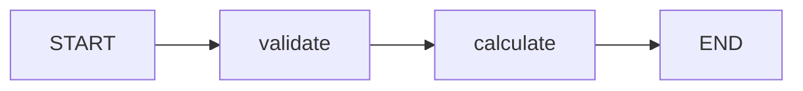
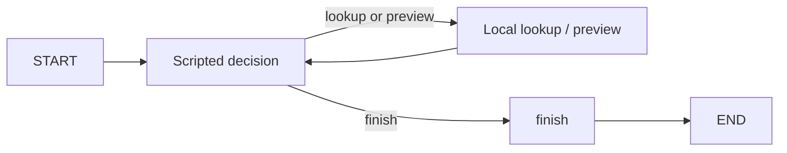

# Validated calculations and order previews

Two runnable examples demonstrate state, conditional routing, streamed execution, and failure handling with LangGraph. All order data is synthetic.

| Example | Behavior |
| --- | --- |
| Validated calculation | Reject invalid inputs, then add or multiply integers. Inputs 2 and 3 produce 5 or 6. |
| Order change preview | Look up a synthetic order, require lookup before preview, and compute proposed totals without changing the order. Quantity 2 at unit price 35 totals 70; quantity 5 would total 175. |

## Run

Python 3.12 is recommended. Create an isolated environment: `python -m venv .venv`.

The first command below installs public dependencies and needs package access. After installation, the two demonstrations and test command run offline; no model, bot, provider account, or API billing is connected.

Windows PowerShell:

```powershell
& .\.venv\Scripts\python.exe -m pip install --index-url https://pypi.org/simple -r requirements.txt
& .\.venv\Scripts\python.exe local_graph.py
& .\.venv\Scripts\python.exe order_preview.py
& .\.venv\Scripts\python.exe -m unittest discover -s . -p 'test_*.py' -v
```

macOS/Linux:

```sh
.venv/bin/python -m pip install --index-url https://pypi.org/simple -r requirements.txt
.venv/bin/python local_graph.py
.venv/bin/python order_preview.py
.venv/bin/python -m unittest discover -s . -p 'test_*.py' -v
```

The dependency lock pins the tested package versions. Installation downloads public packages; the examples contain no provider client, API key, external connector, or billing integration.

## Execution and tests

Validated calculation:



Synthetic order preview:



Calculation streams `validate -> calculate`. The order preview streams `decide -> tool -> decide -> tool -> decide -> finish`. The graphs execute through the installed LangGraph engine. Order decisions are supplied by an explicit scripted local fixture; they are not model inference or autonomous reasoning.

Tests cover correct totals, invalid inputs and quantities, unknown orders/actions, lookup prerequisites, non-object decisions, streamed node order, bounded loops, and unchanged order data. The preview has no apply/update operation or real order backend.

These are disconnected demonstrations, not deployed services or evidence of customer, production, or credential outcomes. [Third-party notices](THIRD_PARTY_NOTICES.md) cover the external graph dependency.
